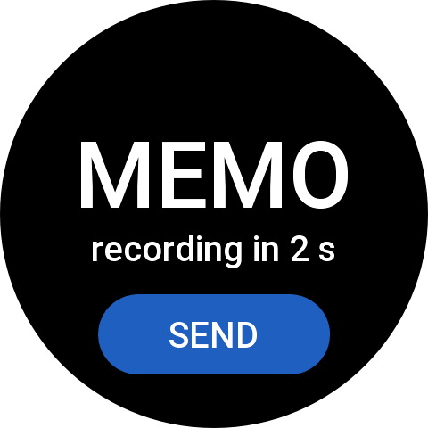
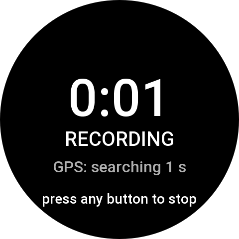
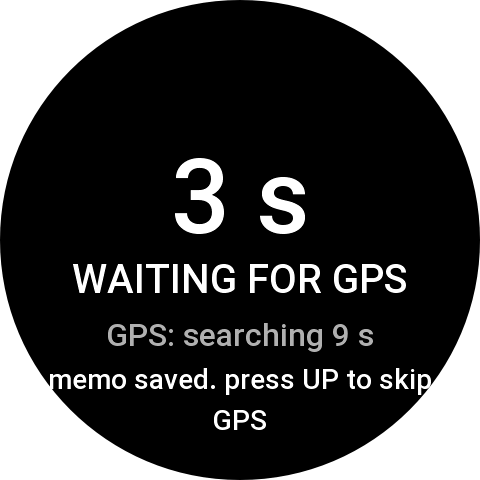
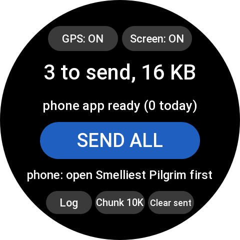

# Smelliest Pilgrim

*[Read in English](README.md)*

Un diario de camino con notas de voz en la muñeca, pensado para peregrinos y
senderistas de largo recorrido.

En una caminata larga, las buenas ideas llegan mientras andas: la vista al
final de una subida, la persona con la que compartiste mesa, cómo van los pies
el día 23. Pararse a escribir cuesta, y al final del día la mitad se ha
olvidado. Con Smelliest Pilgrim le hablas al reloj. Cada nota guarda el lugar
donde la grabaste, se queda segura en el reloj y se envía cuando tienes el
móvil cerca. Por la noche tienes la página del día: horas, lugares en el mapa y
tu propia voz.

Nació en el Camino y sirve para cualquier ruta larga.

(La interfaz del reloj está en inglés.)

## Qué hace

- **Habla, no escribas.** Abre la app y habla: empieza a grabar tras una pausa
  de dos segundos. Pulsa cualquier botón para parar.
- **Cada nota sabe dónde estabas.** El GPS del reloj etiqueta cada nota. Si
  todavía no hay señal, sigue buscando un rato después de parar.
- **Funciona sin conexión.** Sin cobertura en la meseta o en la montaña no pasa
  nada. Las notas se quedan en el reloj hasta que decidas enviarlas.
- **Tu diario es tuyo.** Las notas van a la app Smelliest Pilgrim de tu propio
  móvil (no salen del teléfono) o a tu propio servidor, si configuras uno. Sin
  cuenta, sin anuncios, sin rastreo, y nada se envía nunca al desarrollador.
- **No se pierde nada.** Cada nota se comprueba byte a byte antes de marcarla
  como enviada, y un envío interrumpido continúa donde se quedó.

La app del reloj es para el **Amazfit T-Rex 3** (Zepp OS). La app del móvil
necesita Android 8 o posterior.

## Qué hay en este repositorio

| Carpeta | Qué es |
|---|---|
| [`watch/`](watch/) | La app del reloj (miniprograma de Zepp OS): grabación, GPS, envío y su página de ajustes en la app Zepp. |
| [`android/`](android/) | La app de móvil Smelliest Pilgrim (Android, antes "WatchMemo"): recibe las notas en el mismo móvil y guarda cada día como archivos `.ogg`, con un resumen `day.md` y un zip del día. |
| [`server/`](server/) | Opcional: tu propio servidor de notas en el plan gratuito de Cloudflare (Worker + D1), con una página privada para escuchar, descargar y borrar notas. |
| [`docs/`](docs/) | La declaración de privacidad y la página web del proyecto. |

## Cómo empezar

1. **App del móvil.** Descarga `SmelliestPilgrim-<versión>.apk` de la última
   [versión publicada](../../releases/latest) y ábrelo en tu Android (permite la
   instalación cuando lo pida). El SHA-256 de cada archivo está en `SHA256SUMS`.
   Para actualizaciones automáticas, añade la URL de este repositorio en
   [Obtainium](https://github.com/ImranR98/Obtainium).
2. **App del reloj.** Instala Smelliest Pilgrim en el reloj desde la tienda de
   apps de la app Zepp (cuando esté publicada).
3. **En el camino.** Abre la app en el reloj y habla. Cuando tengas el móvil
   cerca, abre la app Smelliest Pilgrim en el móvil; luego, en el reloj, abre la
   app, pulsa un botón en los dos primeros segundos (o toca SEND) y pulsa
   **SEND ALL**.
4. **Por la tarde.** Toca un día en la app del móvil para escuchar, abrir un
   lugar en Mapas o compartir el zip del día.

### Enviar a tu propio servidor

En la app Zepp: Perfil > tu reloj > Lista de apps > Smelliest Pilgrim > Ajustes.
Elige **My server**, escribe la dirección del servidor y el token, y toca **Test
connection**. [`server/README.md`](server/README.md) (en inglés) explica cómo
montar tu propio servidor gratuito en unos diez minutos.

## Privacidad

En resumen: la voz y el GPS se graban en tu reloj y solo van adonde tú los
envías. El desarrollador no recibe nada. Declaración completa:
[Español](https://smelliestpilgrim.github.io/smelliest-pilgrim/es/privacy.html) ·
[English](https://smelliestpilgrim.github.io/smelliest-pilgrim/privacy.html).

## Licencia

[MIT](LICENSE). ¡Buen Camino!
