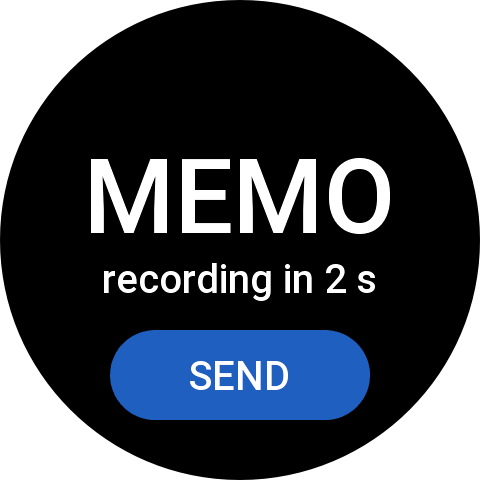
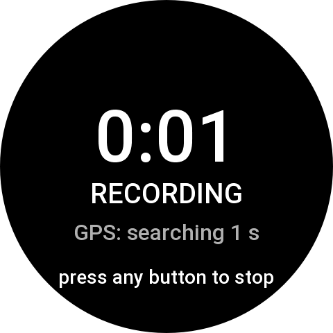
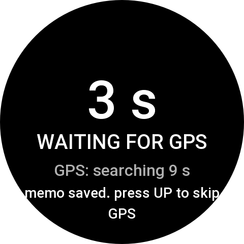
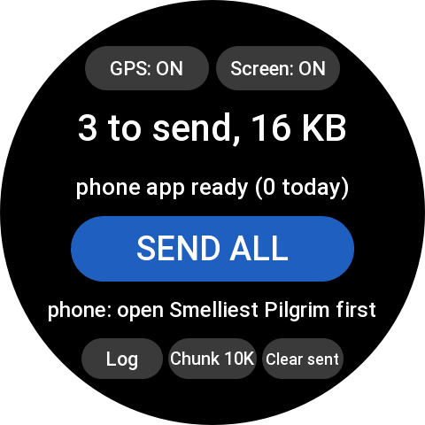

# Smelliest Pilgrim

*[Leer en español](README.es.md)*

A voice-memo trail journal for your wrist, made for pilgrims and thru-hikers.

On a long walk the good thoughts come while you are moving: the view at the top
of a climb, the person you shared a table with, how your feet feel on day 23.
Stopping to type is a chore, and at the end of the day half of it has gone.
Smelliest Pilgrim lets you talk to your watch instead. Each memo is tagged with
where you were, kept safely on the watch, and sent home when you have a phone
nearby. At night you have a day page: times, places on the map, and your own voice.

It was made on the Camino and works for any long trail.

## What it does

- **Talk, don't type.** Open the app and start talking: it records after a
  two-second pause. Press any button to stop.
- **Every memo knows where you were.** The watch's GPS tags each memo. If there
  is no fix yet, it keeps looking for a little while after you stop.
- **Works offline.** No signal on the meseta or in the mountains is fine. Memos
  stay on the watch until you choose to send them.
- **Your journal stays yours.** Memos go to the Smelliest Pilgrim phone app on
  your own phone (nothing leaves the phone), or to your own server if you set one
  up. There is no account, no ads, no tracking, and nothing is ever sent to the
  developer.
- **Nothing gets lost.** Every memo is checked byte for byte before the watch
  marks it as sent, and an interrupted send picks up where it stopped.

The watch app is for the **Amazfit T-Rex 3** (Zepp OS). The phone app needs
Android 8 or newer.

## What's in this repository

| Folder | What it is |
|---|---|
| [`watch/`](watch/) | The watch app (Zepp OS mini program): recording, GPS tags, sending, and its settings page in the Zepp app. |
| [`android/`](android/) | The Smelliest Pilgrim phone app (Android, formerly "WatchMemo"): receives memos on the same phone, keeps one day per folder as `.ogg` files with a `day.md` summary and a day zip. |
| [`server/`](server/) | Optional: your own memo server on Cloudflare's free plan (Worker + D1), with a private web page to play, download and delete memos. |
| [`docs/`](docs/) | The privacy statement and this project's web page. |

## Getting started

1. **Phone app.** Download `SmelliestPilgrim-<version>.apk` from the latest
   [release](../../releases/latest) and open it on your Android phone (allow the
   install when asked). The SHA-256 of each file is in `SHA256SUMS` next to it.
   For automatic updates, add this repository's URL to
   [Obtainium](https://github.com/ImranR98/Obtainium).
2. **Watch app.** Install Smelliest Pilgrim on the watch from the Zepp app's app
   store (once it is listed there).
3. **On the trail.** Open the app on the watch and talk. When you are back with
   your phone, open the Smelliest Pilgrim phone app, then on the watch open the
   app and press a button in the first two seconds (or tap SEND) and press
   **SEND ALL**.
4. **In the evening.** Tap a day in the phone app to listen, open a place in
   Maps, or share the day's zip.

### Sending to your own server instead

In the Zepp app: Profile > your watch > App list > Smelliest Pilgrim > Settings.
Choose **My server**, enter the server address and token, and tap **Test
connection**. [`server/README.md`](server/README.md) explains how to set up a
free server of your own in about ten minutes.

## Privacy

Short version: voice and GPS are recorded on your watch and only go where you
send them. The developer receives nothing. Full statement:
[English](https://smelliestpilgrim.github.io/smelliest-pilgrim/privacy.html) ·
[Español](https://smelliestpilgrim.github.io/smelliest-pilgrim/es/privacy.html).

## Building and testing

- Phone app: `android/build.sh` (JDK 17 + Android SDK build-tools 34, no Gradle).
  Without a keystore it signs with a throwaway debug key. The release signing key
  is not in this repository, so only official releases update an installed copy.
- Watch app: `cd watch && npm install && zeus build` ([Zeus CLI](https://docs.zepp.com/docs/guides/tools/cli/)).
- Tests, no devices needed: `./run_tests.sh` (phone app logic in the JVM, the
  watch's sender and pages on mocked Zepp OS APIs) and `cd server && npm install &&
  npm test` (local Cloudflare Worker, a synthetic day of memos, the memo page in
  headless Chrome). Needs Node 20+, JDK 17, ffmpeg and python3.

## The protocol

The watch's Side Service (running inside the Zepp app) talks plain HTTP to the
phone app on `127.0.0.1:8765`, or HTTPS with a bearer token to your server:

| Route | Body | Reply |
|---|---|---|
| `GET /ping` | | `{"ok":true,"today":N,"offsets":true,"maxChunk":49152}` |
| `POST /chunk?id=&i=&n=&o=` | base64 audio bytes at byte offset `o` | `{"ok":true,"i":i,"o":o,"len":L}` |
| `POST /logpart?id=&i=&n=` | base64 part of the watch log | `{"ok":true,"done":bool}` |
| `POST /commit` | form: `id, size, crc, t, tz, lat, lon, fix, ...` | `{"ok":true,"size":..,"crc":..,"file":"HHMM-SS.ogg","dup":bool}` |

A memo counts as saved only when every byte has arrived and the size and CRC-32
match what the watch computed.

## Licence

[MIT](LICENSE). Buen Camino.
